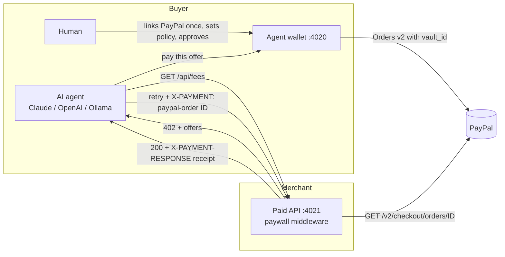

# PayPal 402

HTTP 402 Payment Required, settled through PayPal. AI agents call paid APIs all day, but API billing still assumes a human with a card on a checkout page. Crypto has x402 for machine payments; PayPal 402 brings the same pattern to the 400M+ people who already have PayPal. An API owner wraps a route with a price. When an agent calls it without paying, it gets a 402 with PayPal payment terms. The agent's wallet, which the human linked to PayPal once and capped with a spending policy, pays through the PayPal Orders API and retries. The merchant then verifies the capture with PayPal on the server before serving the response.

## Quickstart (60 seconds)

Requires Node 22.18+ (Node 24 recommended). No accounts needed for the first run.

```bash
npm install
cp .env.example .env      # optional; everything has defaults
npm run demo              # dashboard on :4020, paid API on :4021
```

Open http://localhost:4020 and click **Link PayPal**, then **Run agent**. In another terminal:

```bash
npm run agent -- "What fee gets my BTC tx confirmed within an hour? Summarize the mempool."
npm test
```

Without PayPal credentials the demo uses a built-in mock PayPal that has the same interface and response shapes as the REST adapter, with local approval pages. Without an AI key, a scripted planner runs the same tools so the payment flow still works end to end. It is clearly labeled in the UI and is not an AI model.

| Set in `.env` | Effect |
| --- | --- |
| `PAYPAL_CLIENT_ID`, `PAYPAL_CLIENT_SECRET`, `MERCHANT_SECRET` | Real PayPal sandbox (OAuth2, Orders v2, Vault v3) |
| `ANTHROPIC_API_KEY` | Claude agent (`ANTHROPIC_MODEL`, default `claude-sonnet-5-5`) |
| `OPENAI_API_KEY` | OpenAI-compatible agent (`OPENAI_MODEL`, `OPENAI_BASE_URL`) |
| `OLLAMA_URL` | Local model via Ollama's OpenAI-compatible API (`OLLAMA_MODEL`) |
| `MEMPOOL_OFFLINE=1` | Bundled sample data instead of live mempool.space |

### Using PayPal sandbox

1. At developer.paypal.com, create a sandbox REST app. Under **Sandbox App Settings > Features**, enable **Accept payments** and, under **Advanced options**, **Vault** (needed for "save PayPal" without a purchase).
2. Put the client ID and secret in `.env`, plus any random 16+ character `MERCHANT_SECRET`.
3. Run `npm run demo`, click **Link PayPal**, and sign in with a sandbox personal account.

## Architecture



| Path | What it is |
| --- | --- |
| `src/server/paywall.ts` | Express middleware: `app.get("/x", paywall.charge({ price: "0.05" }), handler)` |
| `src/server/protocol.ts` | Wire format shared by server and client |
| `src/wallet/` | Buyer wallet: Vault v3 linking, spending policy, approvals, ledger |
| `src/agent/` | Tool-use agent, provider adapters, 402-aware HTTP client, CLI |
| `src/paypal/` | `RestPayPal` (sandbox/live REST) and `MockPayPal` behind one interface |
| `src/demo/` | Fee oracle merchant (mempool.space data), demo server, mock approval pages |
| `public/` | Dashboard: agent run timeline, wallet, policy, approvals, merchant revenue |

## How the 402 flow works

1. **Unpaid call.** `GET /api/fees/recommend` returns `402` with:
   ```json
   {
     "protocol": "paypal-402/1",
     "error": "payment_required",
     "resource": "GET /api/fees/recommend",
     "merchant": { "name": "Fee Oracle" },
     "accepts": [
       { "id": "p402.c.<exp>.<nonce>.<sig>", "scheme": "paypal-order", "kind": "per_call", "amount": "0.05", "currency": "USD", "calls": 1, "expiresAt": 1762629000 },
       { "id": "p402.b.<exp>.<nonce>.<sig>", "scheme": "paypal-order", "kind": "bundle", "amount": "1.00", "currency": "USD", "calls": 50, "expiresAt": 1762629000 }
     ],
     "header": "X-PAYMENT",
     "formats": { "order": "paypal-order <PayPal order id>", "credit": "paypal-credit <credit token>" }
   }
   ```
   The offer `id` is an HMAC over route, amount, currency, expiry and nonce, so the merchant stays stateless until something is paid.
2. **Policy.** The agent asks its wallet to pay an offer. The wallet checks the allowed merchants, the per-call cap (bundles are judged by unit price), the daily budget and the approval threshold. If the payment needs approval, it waits for the human in the dashboard.
3. **Payment.** The wallet creates a PayPal order with `intent: CAPTURE`, `custom_id` set to the offer id, and `payment_source.paypal.vault_id` set to the saved payment token, so no browser is needed. `PayPal-Request-Id` is derived from the offer id, which makes retries idempotent. If no PayPal account is linked yet, the wallet creates a normal checkout order instead, and the human approves that one payment on PayPal.
4. **Retry with proof.** `X-PAYMENT: paypal-order <id>`. The middleware fetches the order from PayPal and checks:
   - `custom_id` is a valid offer for this route
   - the amount and currency match
   - the order and capture are `COMPLETED`
   - the payee matches, if one is configured
   - the order id has never been redeemed

   An order that is `APPROVED` but not yet captured is captured server-side.
5. **Receipt.** `X-PAYMENT-RESPONSE` (base64url JSON) carries the order id, capture id and amount. A bundle also returns a credit token. Later calls send `X-PAYMENT: paypal-credit <token>`, and each one atomically decrements the balance.

## Security notes

- **Server-side verification only.** The merchant never trusts the client's claim. Every order id is checked with the PayPal Orders API using the merchant's own credentials.
- **Replay protection.** Redeemed order ids are a SQLite primary key, so redemption is atomic even under concurrent retries. Credits decrement with a guarded `UPDATE ... WHERE remaining > 0`. Tests cover both.
- **Offer binding.** An order paid for one route, a lower amount, an expired offer or another merchant's secret is rejected.
- **The LLM never holds money.** It can only ask the wallet to pay. Budget caps, allowed origins and approval thresholds are enforced in the wallet service, not in the prompt. The agent key can request payments, but it cannot change policy or approve: those need the owner session (403 otherwise, covered by tests). The agent's HTTP tools can only reach origins on the allow list.
- **Secrets.** Credentials come from env only, and `.env` is git-ignored.

Known limits are listed in [docs/DEVPOST.md](docs/DEVPOST.md#challenges-we-ran-into).

## Scripts

| Command | Does |
| --- | --- |
| `npm run demo` | Start merchant API + wallet/dashboard |
| `npm run agent -- "<task>"` | Run the agent from the terminal against a running demo |
| `npm test` | Unit + end-to-end tests (mock PayPal, offline data) |
| `npm run typecheck` | `tsc --noEmit` |

## License

MIT
